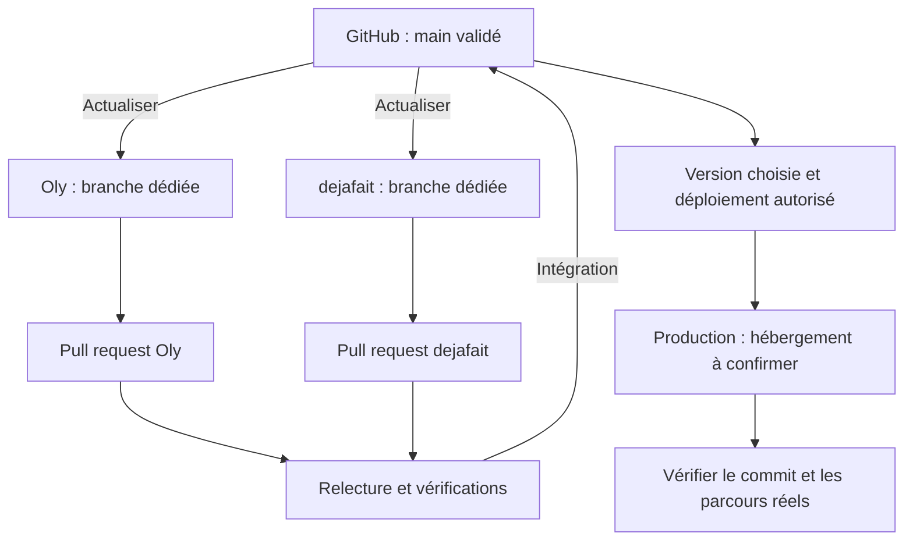

# Match Europe Flask

Application web de la bêta EURES, destinée à recueillir les informations des candidats et les besoins des employeurs, et à accompagner leur mise en relation.

Ce dépôt contient l’application historique **Flask + Grist**. Il ne constitue pas encore le futur socle Match Europe Django + PostgreSQL.

## Un projet développé avec l’IA, ouvert aux non-développeurs

Le projet est développé selon une démarche de **vibe coding** : des outils d’intelligence artificielle aident à produire et à modifier le code à partir de besoins exprimés en langage naturel. Des personnes qui ne sont pas développeuses participent à la définition des besoins, aux essais, à la documentation et à l’évolution du service.

Ce README s’adresse donc à des lecteurs ayant des niveaux d’expérience technique différents. Il explique volontairement des notions de base et détaille certaines étapes qui peuvent sembler évidentes, voire très élémentaires, à un développeur expérimenté. Ce choix permet à chacun de comprendre le fonctionnement du projet et de contribuer sans devoir déjà maîtriser Git, les pull requests ou le déploiement.

Le recours à l’IA et l’accessibilité de la documentation ne dispensent pas de vérifier le code, de tester les changements et de faire relire les contributions avant leur intégration. Les décisions fonctionnelles et techniques restent sous la responsabilité des personnes qui portent le projet.

## Ce que contient le dépôt

- Formulaires EURES : `/forms/eures-beta/*`.
- API d’enregistrement : `/api/forms/eures-beta/record`.
- Statistiques publiques : `/api/forms/eures-beta/public-stats`.
- Administration : `/admin/eures-beta/`.
- Suivi projet : `/admin/eures-beta/suivi`.
- Interfaces en français, anglais et allemand.
- Connexion à Grist, envoi d’e-mails via Brevo et traduction automatique optionnelle via OpenAI.

Une fonctionnalité en cours de développement n’est pas considérée comme disponible en production du seul fait de sa présence dans une branche.

## Où se trouve la version de référence ?

Le dépôt commun est [eures-beta/match-europe-flask](https://github.com/eures-beta/match-europe-flask).

- **GitHub / `main`** : version commune après intégration et validation.
- **Copies locales** : environnements de travail, chacun dans un dossier ou un worktree séparé.
- **Production** : version précise déployée et vérifiée, qui peut être antérieure à `main`.

Le code est indépendant de l’hébergeur. Les paramètres et procédures d’exploitation propres aux environnements sont conservés séparément dans les dépôts privés de déploiement.

## Circuit du code jusqu’à la production



## Travailler ensemble

Les règles suivantes constituent le fonctionnement proposé. Leur application automatique dépendra des protections configurées sur GitHub.

1. Vérifier le dépôt, la branche et les modifications locales avant de commencer. Préserver tout travail existant.
2. Actualiser `main` depuis GitHub, puis créer une branche dédiée à un seul chantier, par exemple `docs/readme-collaboration`.
3. Réaliser les changements et les vérifications adaptées.
4. Créer un commit, publier la branche et ouvrir une **pull request (PR)** vers `main`.
5. Faire relire la PR par une autre personne. Décrire les changements, les vérifications et les limites connues.
6. Intégrer la PR après validation, puis actualiser les copies locales de `main`.

Éviter de coder directement sur `main`. Deux intervenants ne doivent pas modifier simultanément le même dossier de travail. Si deux branches modifient les mêmes lignes, résoudre les conflits et vérifier le résultat avant intégration.

## Installer et lancer en local

Prérequis : Git et `uv`. Le projet demande Python 3.10 minimum ; `.python-version` indique Python 3.13.

```bash
git clone https://github.com/eures-beta/match-europe-flask.git
cd match-europe-flask
uv sync --locked
cp .env.example .env
```

Renseigner `.env` avec une configuration de développement autorisée. Le chargement de ce fichier est assuré par l’application.

**Attention : les formulaires et l’administration peuvent écrire dans Grist et envoyer des e-mails.** Utiliser un document et des accès de test dédiés. Ne pas reprendre les accès de production pour un essai local sans autorisation explicite.

```bash
uv run flask --app app.py run -p 5005
```

L’application est accessible sur `http://localhost:5005/forms/eures-beta/`.

### Taille des requêtes

Le CV candidat reste limité à **3 Mio**. Le POST d’enregistrement autorise **5 Mio** de JSON pour inclure son encodage base64 et les autres réponses ; les autres endpoints conservent la limite de **2 Mio**. Un dépassement du corps HTTP renvoie 413, et un CV dépassant son plafond métier reste refusé. Cette limite par requête nécessite Flask 3.1 ou ultérieur.

### Configuration

Le fichier `.env.example` fournit les premiers paramètres. Les principaux groupes sont :

- **Grist** : `GRIST_API_KEY`, `GRIST_BASE_URL`, `GRIST_DOC_EURES_BETA` et noms des tables candidates, employeurs, statistiques et suivi projet.
- **Administration** : identifiants, mode d’authentification, liste des e-mails autorisés et durée de validité des liens de connexion.
- **URL publique** : `PUBLIC_APP_BASE_URL` pour construire les liens hors requête ; pendant une requête, son origine sert de valeur par défaut.
- **Brevo** : clé API, adresse et nom de l’expéditeur.
- **OpenAI, optionnel** : `OPENAI_API_KEY` et `OPENAI_TEXT_MODEL` pour la traduction automatique.

Ne jamais publier de clés API, de mots de passe, de fichiers `.env` ou de données personnelles dans le dépôt, une PR ou ses pièces jointes.

## Vérifier les changements

La commande de tests documentée pour le socle actuel est :

```bash
uv run python -m unittest tests.test_public_stats tests.test_eures_beta_only_mode tests.test_tracking_module
```

Ajouter les vérifications adaptées aux modules modifiés. Pour une PR portant uniquement sur le README, vérifier le contenu, les liens et le rendu GitHub ; un déploiement de l’application n’est pas nécessaire.

## Suivi projet EURES

Le module de suivi projet est intégré nativement dans l'admin EURES via `/admin/eures-beta/suivi`.

### Modèle de carte

Chaque carte possède une référence visible de type `EURES-123` et s'appuie sur les champs métier suivants :

- `titre`
- `responsable`
- `source`
- `description`
- `observe`
- `attendu`
- `contexte`
- `indicateurs_suivi`
- `priorite`
- `type`
- `statut`
- `taille_dev`
- `images`
- `liens`
- `commentaires`
- `historique`
- informations GitHub / PR / déploiement

### Règles métier

- `Fait` reste une colonne active du kanban.
- `Archiver` sort la carte du flux actif sans la supprimer.
- `Supprimer` efface définitivement la carte.
- il n'existe pas de champ séparé `Bloquant` ; utiliser la priorité `critique`.

### CRUD et persistance

Le module réutilise les helpers CRUD Grist du projet :

- lecture par table et par id
- `update_table_record_by_id`
- contrat de suppression identique aux autres suppressions Grist du projet

### Texte libre

La création rapide crée directement une carte. Le titre est condensé avant enregistrement et les validations métier sont les mêmes que pour une création manuelle.

### Images jointes

- compression côté navigateur avant envoi
- volume et nombre limités
- aperçu, ouverture et retrait dans le drawer
- historisation de l'ajout et du retrait d'image

### GitHub, PR et déploiement

- webhook GitHub signé HMAC : `/api/forms/eures-beta/tracking/github/webhook`
- webhook de déploiement : `/api/forms/eures-beta/tracking/deployments/webhook`
- compatibilité actuelle :
  - signature HMAC `X-Tracking-Signature-256` recommandée
  - ancien secret d'en-tête `X-Tracking-Webhook-Secret` encore accepté pour migration douce

La carte conserve :

- branche GitHub
- URL de PR
- état de PR
- dernière activité GitHub
- URL de déploiement
- environnement
- date de déploiement

### i18n et fallbacks

L'interface est disponible en FR / EN / DE. Les messages visibles côté backend utilisés par le module de suivi sont également localisés. Si la traduction automatique n'est pas configurée, un fallback manuel explicite est affiché.

### Idempotence et hypothèses

L'anti double-enregistrement repose aujourd'hui sur :

- un garde-fou frontend
- un verrou mémoire côté backend

Le `Procfile` impose un seul worker synchrone et un seul thread, compatibles avec ce verrou process-local. Un mode multi-worker ou multi-instance nécessitera une idempotence persistante et un état de sécurité partagé avant son activation.


### Worker timeout and concurrency

The Procfile explicitly runs one synchronous worker and one thread, even if `WEB_CONCURRENCY` is set. This preserves process-local locking and authentication state. Automatic request-count recycling is explicitly disabled: current one-time-token and throttle state is process-local, so predictable recycling would reset that state. The default request timeout remains 30 seconds (`GUNICORN_TIMEOUT` can override it). Worker crashes and restarts still invalidate in-memory token/throttle state; do not treat it as durable protection. Set a stable `SESSION_SECRET` in production to preserve sessions across restarts. Multi-worker/multi-instance operation requires durable idempotence, shared one-time-token/throttle state and shared session secrets first. This change does not claim to solve all request-level denial of service.

### Browser security headers

Admin scripts are served from same-origin files in `assets/admin/`, allowing an enforced CSP without inline-script exceptions. Test admin pages after adding scripts or external resource origins. HSTS is disabled by default; set `SECURITY_HSTS_MAX_AGE` to a non-negative number of seconds only after HTTPS is verified. It is emitted only for HTTPS requests and does not include subdomains.
### Error responses and diagnostics

Server/upstream failures use generic FR/EN/DE responses. Exception messages, tracebacks, raw upstream responses and redirect URLs are not returned to clients or copied into the affected application error logs/failure notes. Logs retain stable operation names and safe HTTP status codes. Local validation errors remain actionable. Brevo health diagnostics expose HTTP status rather than an upstream error message. Reverse-proxy/platform logging must be reviewed separately; this change does not configure external log collectors.
